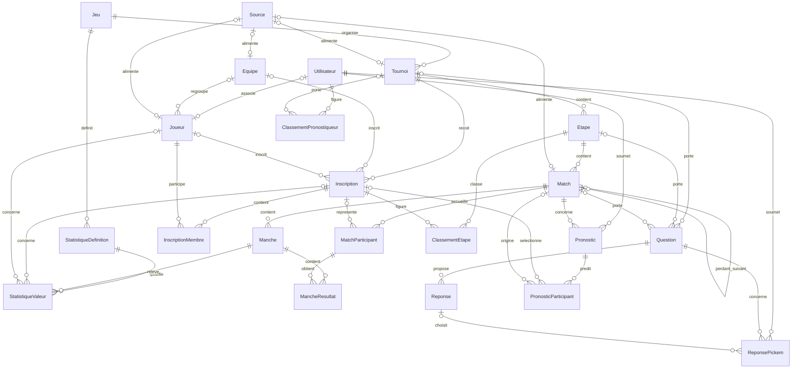

# Modèle de données v1

Le schéma Prisma cible PostgreSQL. La liste d'entités du sujet est un minimum, pas une liste fermée : les comptes, participants et résultats complémentaires sont nécessaires aux fonctionnalités du projet.

- Schéma : [`apps/api/prisma/schema.prisma`](../../apps/api/prisma/schema.prisma).
- Migration initiale : [`apps/api/prisma/migrations/20261120120000_init/migration.sql`](../../apps/api/prisma/migrations/20261120120000_init/migration.sql).
- Les tables SQL sont nommées en snake_case pluriel ; les colonnes gardent les noms Prisma.
- Toutes les dates sont en `timestamptz(3)`. Les identifiants `id` sont des chaînes CUID générées par Prisma.

## Diagramme entité-relation



## Dictionnaire des champs

Toutes les entités ont `id` (clé primaire CUID), `createdAt` (date de création, `now()`) et `updatedAt` (date de mise à jour gérée par Prisma). Ils ne sont pas répétés dans les tableaux. Les champs de relation Prisma sans colonne propre sont indiqués dans le diagramme ; les clés étrangères sont listées ci-dessous. `?` signifie nullable.

### Utilisateur

| Champ          | Type   | Description                                           |
| -------------- | ------ | ----------------------------------------------------- |
| pseudo         | String | Unique ; nom du compte                                |
| email          | String | Unique ; adresse de connexion                         |
| motDePasseHash | String | Hash du mot de passe, jamais le mot de passe en clair |
| role           | Role   | `ADMIN` ou `UTILISATEUR` (défaut)                     |

Un joueur importé peut ne pas avoir de compte ; un spectateur peut pronostiquer sans inscription.

L'unicité de `email` et `pseudo` est actuellement sensible à la casse. Le choix entre normalisation applicative et unicité insensible à la casse en base est reporté à l'authentification (#17).

### Jeu et statistiques

| Entité                | Champ         | Type            | Description                                 |
| --------------------- | ------------- | --------------- | ------------------------------------------- |
| Jeu                   | slug          | String          | Unique ; identifiant public                 |
| Jeu                   | nom           | String          | Nom                                         |
| Jeu                   | editeur       | String?         | Éditeur                                     |
| StatistiqueDefinition | jeuId         | String          | FK vers Jeu                                 |
| StatistiqueDefinition | cle           | String          | Unique par jeu                              |
| StatistiqueDefinition | libelle       | String          | Nom affiché                                 |
| StatistiqueDefinition | type          | StatistiqueType | `LISTE`, `ENTIER`, `BOOLEEN` ou `JOUEUR`    |
| StatistiqueDefinition | options       | Json?           | Valeurs possibles pour une liste            |
| StatistiqueValeur     | mancheId      | String          | FK vers Manche                              |
| StatistiqueValeur     | definitionId  | String          | FK vers StatistiqueDefinition               |
| StatistiqueValeur     | inscriptionId | String?         | FK vers l'inscription concernée             |
| StatistiqueValeur     | joueurId      | String?         | FK vers le joueur concerné                  |
| StatistiqueValeur     | valeur        | Json            | Valeur relevée, validée selon la définition |

Une valeur peut concerner la manche entière, une inscription, un joueur ou un joueur dans une inscription. Des index partiels assurent son unicité dans chacun de ces cas. Les agrégats sont dérivés, pas stockés comme statistiques.

### Tournoi et étape

| Entité  | Champ                            | Type              | Description                                                                 |
| ------- | -------------------------------- | ----------------- | --------------------------------------------------------------------------- |
| Tournoi | jeuId                            | String            | FK vers Jeu                                                                 |
| Tournoi | sourceId                         | String?           | FK unique vers Source                                                       |
| Tournoi | nom                              | String            | Nom                                                                         |
| Tournoi | slug                             | String            | Unique ; identifiant public                                                 |
| Tournoi | lieu                             | TournoiLieu       | `EN_LIGNE`, `PRESENTIEL`, `MIXTE`                                           |
| Tournoi | visibilite                       | TournoiVisibilite | `PUBLIQUE`, `INVITATION`                                                    |
| Tournoi | description                      | String?           | Présentation                                                                |
| Tournoi | reglement                        | String?           | Règlement                                                                   |
| Tournoi | modeParticipant                  | ModeParticipant   | `SOLO`, `EQUIPE`                                                            |
| Tournoi | tailleEquipeMin, tailleEquipeMax | Int?              | Bornes d'effectif                                                           |
| Tournoi | modePronostic                    | ModePronostic     | `MATCH`, `ARBRE`, `LES_DEUX`                                                |
| Tournoi | statut                           | TournoiStatut     | `DRAFT` (défaut), `UPCOMING`, `LIVE`, `COMPLETED`, `ARCHIVED`               |
| Tournoi | commenceAt, termineAt            | DateTime?         | Début et fin                                                                |
| Etape   | tournoiId                        | String            | FK vers Tournoi ; unique avec ordre                                         |
| Etape   | nom                              | String            | Nom                                                                         |
| Etape   | ordre                            | Int               | Ordre dans le tournoi                                                       |
| Etape   | type                             | EtapeType         | `QUALIFICATION`, `GROUP_STAGE`, `PLAYOFF`, `GRAND_FINAL`                    |
| Etape   | format                           | TournoiFormat     | `SINGLE_ELIMINATION`, `DOUBLE_ELIMINATION`, `GROUP_STAGE`, `SWISS`, `FFA`   |
| Etape   | config                           | Json              | Règles propres à l'étape : BO, barème, départage, seeding et qualifications |
| Etape   | modePronostic                    | ModePronostic?    | Surcharge du mode du tournoi ; NULL signifie héritage                       |
| Etape   | statut                           | EtapeStatut       | `UPCOMING` (défaut), `LIVE`, `COMPLETED`                                    |
| Etape   | commenceAt, termineAt            | DateTime?         | Début et fin                                                                |

### Match et manche

| Entité           | Champ                                         | Type          | Description                                                                      |
| ---------------- | --------------------------------------------- | ------------- | -------------------------------------------------------------------------------- |
| Match            | etapeId                                       | String        | FK vers Etape ; unique avec ordre                                                |
| Match            | sourceId                                      | String?       | FK unique vers Source                                                            |
| Match            | matchSuivantVainqueurId, slotSuivantVainqueur | String?, Int? | Match et slot destinataires du vainqueur                                         |
| Match            | matchSuivantPerdantId, slotSuivantPerdant     | String?, Int? | Match et slot destinataires du perdant                                           |
| Match            | ordre                                         | Int           | Position dans l'étape                                                            |
| Match            | tour                                          | Int           | Tour dans l'arbre                                                                |
| Match            | bracket                                       | BracketCote?  | `WINNER`, `LOSER`, `GRAND_FINAL`                                                 |
| Match            | bestOf                                        | Int           | Nombre maximal de manches, défaut 1                                              |
| Match            | statut                                        | MatchStatut   | `SCHEDULED` (défaut), `LIVE`, `COMPLETED`, `FORFEIT`, `DISQUALIFIED`, `CANCELED` |
| Match            | dureeEstimee                                  | Int?          | Durée estimée en minutes                                                         |
| Match            | emplacement                                   | String?       | Poste, table ou terrain                                                          |
| Match            | commenceAt, termineAt                         | DateTime?     | Début et fin                                                                     |
| MatchParticipant | matchId                                       | String        | FK vers Match                                                                    |
| MatchParticipant | inscriptionId                                 | String?       | FK vers Inscription ; NULL pour slot inconnu ou exempt                           |
| MatchParticipant | slot                                          | Int           | Unique par match                                                                 |
| MatchParticipant | score, placement                              | Int?          | Score et classement du participant                                               |
| Manche           | matchId                                       | String        | FK vers Match ; unique avec numero                                               |
| Manche           | numero                                        | Int           | Numéro de manche                                                                 |
| Manche           | joueAt                                        | DateTime?     | Date de jeu                                                                      |
| MancheResultat   | mancheId, matchId                             | String        | FK composite vers la manche et son match                                         |
| MancheResultat   | participantId, matchId                        | String        | FK composite vers le participant du même match                                   |
| MancheResultat   | score, placement                              | Int?          | Résultat du participant dans la manche                                           |

Les deux champs de chaque destination d'arbre doivent être renseignés ensemble. Les relations vers les matchs suivants empêchent leur suppression isolée tant qu'ils sont référencés. Le gagnant est déduit du résultat et des règles, sans cache `equipeGagnante`.

### Équipes, joueurs et inscriptions

| Entité            | Champ                         | Type              | Description                                                            |
| ----------------- | ----------------------------- | ----------------- | ---------------------------------------------------------------------- |
| Equipe            | sourceId                      | String?           | FK unique vers Source                                                  |
| Equipe            | nom                           | String            | Nom                                                                    |
| Equipe            | tag, logoUrl                  | String?           | Tag et URL du logo                                                     |
| Joueur            | sourceId                      | String?           | FK unique vers Source                                                  |
| Joueur            | utilisateurId                 | String?           | FK unique vers Utilisateur                                             |
| Joueur            | equipeId                      | String?           | FK vers l'équipe courante                                              |
| Joueur            | pseudo                        | String            | Pseudonyme de jeu                                                      |
| Joueur            | nomAffiche, role, nationalite | String?           | Nom, rôle et pays                                                      |
| Inscription       | tournoiId                     | String            | FK vers Tournoi                                                        |
| Inscription       | equipeId, joueurId            | String?           | FK vers Equipe ou Joueur ; exactement une cible, unique par tournoi    |
| Inscription       | seed                          | Int?              | Seed initial                                                           |
| Inscription       | statut                        | InscriptionStatut | `PENDING` (défaut), `CONFIRMED`, `WAITLISTED`, `REJECTED`, `WITHDRAWN` |
| Inscription       | inscritAt                     | DateTime          | Date d'inscription, défaut `now()`                                     |
| Inscription       | checkInAt                     | DateTime?         | Date de confirmation de présence                                       |
| Inscription       | champsPersonnalises           | Json?             | Réponses aux champs d'inscription                                      |
| InscriptionMembre | inscriptionId, joueurId       | String            | FK ; paire unique                                                      |
| InscriptionMembre | role                          | MembreRole        | `TITULAIRE`, `REMPLACANT`                                              |

L'effectif d'une inscription est distinct de l'équipe courante d'un joueur. La suppression d'un joueur ou d'une équipe encore inscrit est refusée plutôt que de casser la contrainte de cible exclusive.

### Questions, réponses et pronostics

| Entité                   | Champ                       | Type                | Description                                                            |
| ------------------------ | --------------------------- | ------------------- | ---------------------------------------------------------------------- |
| Question                 | tournoiId, etapeId, matchId | String?             | FK ; exactement une portée                                             |
| Question                 | modele                      | String              | Identifiant du modèle Pick'em, validé par le futur registre applicatif |
| Question                 | statut                      | QuestionStatut      | `OUVERTE` (défaut), `FERMEE`, `RESOLUE`, `ANNULEE`                     |
| Question                 | intitule                    | String              | Texte                                                                  |
| Question                 | configResolution            | Json                | Paramètres et données de résolution                                    |
| Question                 | pointsBase                  | Int                 | Points de base, défaut 0                                               |
| Question                 | ouvertAt, fermeAt           | DateTime            | Fenêtre de réponse                                                     |
| Reponse                  | questionId                  | String              | FK vers Question                                                       |
| Reponse                  | code                        | String              | Unique par question                                                    |
| Reponse                  | libelle                     | String              | Texte                                                                  |
| Reponse                  | estCorrecte                 | Boolean?            | Résultat connu ou non                                                  |
| ReponsePickem            | utilisateurId, questionId   | String              | FK ; une réponse par utilisateur et question                           |
| ReponsePickem            | reponseId                   | String?             | Choix prédéfini appartenant à la question                              |
| ReponsePickem            | valeur                      | Json?               | Réponse libre : nombre, classement, etc.                               |
| Pronostic                | utilisateurId, matchId      | String              | FK ; un pronostic par utilisateur et match                             |
| PronosticParticipant     | pronosticId                 | String              | FK vers Pronostic                                                      |
| PronosticParticipant     | inscriptionId               | String?             | Inscription prédite si connue                                          |
| PronosticParticipant     | matchOrigineId              | String?             | Match précédent si l'inscription n'est pas encore connue               |
| PronosticParticipant     | resultatOrigine             | ResultatOrigine?    | `VAINQUEUR` ou `PERDANT` du match précédent                            |
| PronosticParticipant     | slot                        | Int                 | Slot prédit, unique par pronostic                                      |
| PronosticParticipant     | score, placement            | Int?                | Score et rang prédits ; rang 1 désigne le vainqueur                    |
| Pronostic, ReponsePickem | statut                      | PronosticStatut     | `SUBMITTED` (défaut), `LOCKED`, `SCORED`, `CANCELED`                   |
| Pronostic, ReponsePickem | pointsObtenus               | Int                 | Points attribués, défaut 0                                             |
| Pronostic, ReponsePickem | soumisAt, evalueAt          | DateTime, DateTime? | Soumission (défaut `now()`) et évaluation                              |

Une réponse Pick'em possède soit un choix prédéfini, soit une valeur JSON. La FK composite garantit que le choix appartient à la question. La suppression d'une question supprime ses choix et réponses ; la suppression isolée d'un choix utilisé est refusée. Un participant prédit référence soit une inscription, soit le vainqueur ou perdant d'un match précédent ; un seul rang 1 est autorisé par pronostic. La suppression de son inscription ou de son match d'origine supprime cette ligne de prédiction : le pronostic doit alors être recalculé. Le perdant d'un match à plus de deux participants nécessite une règle spécifique à définir.

Le registre de modèles de l'issue #60 validera `Question.modele` et couvrira les cinq modèles prévus : le plus choisi, le meilleur sur une statistique, total ou nombre, classement, et oui ou non. Il n'est pas encore implémenté ; la base accepte donc tout identifiant de modèle.

### Classements et sources

| Entité                                   | Champ                  | Type           | Description                                                      |
| ---------------------------------------- | ---------------------- | -------------- | ---------------------------------------------------------------- |
| ClassementEtape                          | etapeId, inscriptionId | String         | FK ; paire unique                                                |
| ClassementEtape                          | details                | Json?          | Détails calculés de départage, par exemple victoires ou Buchholz |
| ClassementPronostiqueur                  | utilisateurId          | String         | FK vers Utilisateur                                              |
| ClassementPronostiqueur                  | tournoiId              | String?        | FK vers Tournoi ; NULL pour le classement général                |
| ClassementEtape, ClassementPronostiqueur | points                 | Int            | Points calculés, défaut 0                                        |
| ClassementEtape, ClassementPronostiqueur | rang                   | Int            | Rang calculé                                                     |
| ClassementEtape, ClassementPronostiqueur | calculeAt              | DateTime       | Date du calcul, défaut `now()`                                   |
| Source                                   | provider               | SourceProvider | `START_GG`, `FILE_IMPORT`, `MANUAL`                              |
| Source                                   | externalId             | String         | Unique avec provider                                             |
| Source                                   | url                    | String?        | URL de la donnée publique                                        |
| Source                                   | payload                | Json?          | Données brutes importées                                         |
| Source                                   | synchroniseAt          | DateTime?      | Dernière synchronisation                                         |

Les classements sont des caches recalculables. Un index partiel garantit une seule ligne générale par utilisateur. Les classements de saison et de groupe sont reportés aux issues #47 et #67. `sourceId` est unique dans chaque table importable ; l'application doit également éviter de réutiliser une même source entre types d'entités.

## Règles à valider dans l'application

Les contraintes de clés étrangères et d'unicité ne suffisent pas à exprimer toutes les règles métier. L'application doit notamment vérifier :

- la cohérence tournoi/étape/match/inscription, le jeu de la définition statistique et la participation des joueurs ;
- le type et les options des valeurs statistiques et réponses JSON, et la structure des configurations ;
- les valeurs positives des tailles d'équipe, l'effectif, les dates, les scores, les rangs, et les transitions de statut ;
- la cohérence et l'absence de cycle dans l'arbre, ainsi que l'origine des participants prédits.

La base exige les deux bornes de taille pour les tournois en équipe, leur ordre croissant si elles sont renseignées, et `bestOf >= 1`.

Le projet utilise Prisma 6.19.3 via le lockfile. Une future migration vers Prisma 7 devra notamment adapter `prisma.config.ts`, le générateur et la configuration de connexion ; elle est hors du périmètre de cette version.

Les tables Saison, Groupe, JournalAudit, HistoriquePoints, Badge, Titre, Litige, DeclarationResultat, Notification, lot d'import et modèle de tournoi restent dans leurs issues dédiées.

## Validation locale

Configurer `DATABASE_URL` vers une base PostgreSQL **vide et dédiée**. Depuis la racine :

```bash
pnpm install
pnpm --filter @epickem/api exec prisma validate
pnpm --filter @epickem/api prisma:generate
pnpm --filter @epickem/api prisma:deploy
```

Pour créer une migration ultérieure en développement : `pnpm --filter @epickem/api prisma:migrate --name nom_du_changement`. Les contraintes `CHECK` et index partiels sont ajoutés manuellement à la migration SQL : Prisma ne les représente pas dans le schéma.

Pour tester les contraintes SQL, après déploiement sur une base de test dédiée, exécuter `psql -v ON_ERROR_STOP=1 -f apps/api/prisma/tests/modele-v1.sql` avec les paramètres de connexion de cette base. Le script utilise une transaction annulée à la fin.
