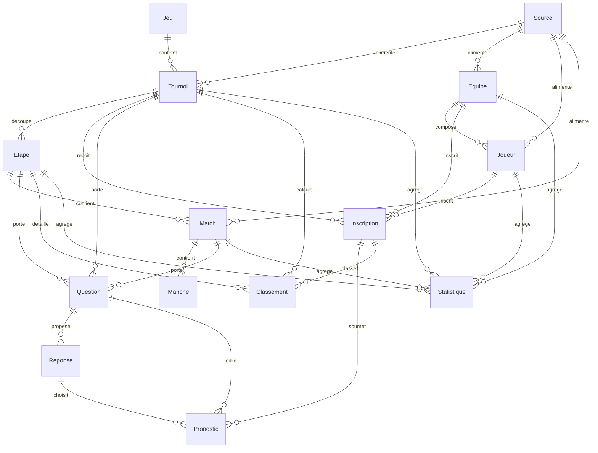

# Modele de donnees v1

Ce document decrit le schema Prisma v1 pour EPICKEM, cible PostgreSQL.

Objectifs de la v1:

- couvrir les entites coeur tournoi et pick'em;
- rendre les imports tracables via une source externe;
- fournir une base stable pour l'API et les calculs de classement.

## Base et emplacement

- Base cible: PostgreSQL (`DATABASE_URL`)
- Schema Prisma: `apps/api/prisma/schema.prisma`
- Migration initiale: `apps/api/prisma/migrations/20261120120000_init/migration.sql`

## Diagramme entite-relation



## Dictionnaire des champs

### Jeu

| Champ     | Type          | Nullable | Contraintes | Description                        |
| --------- | ------------- | -------- | ----------- | ---------------------------------- |
| id        | String (cuid) | non      | PK          | Identifiant technique du jeu       |
| slug      | String        | non      | UNIQUE      | Cle stable pour URLs et references |
| nom       | String        | non      |             | Nom du jeu                         |
| editeur   | String        | oui      |             | Editeur du jeu                     |
| createdAt | DateTime      | non      | default now | Date de creation                   |
| updatedAt | DateTime      | non      | updatedAt   | Date de mise a jour                |

### Source

| Champ         | Type                | Nullable | Contraintes                  | Description                             |
| ------------- | ------------------- | -------- | ---------------------------- | --------------------------------------- |
| id            | String (cuid)       | non      | PK                           | Identifiant technique                   |
| provider      | Enum SourceProvider | non      | index                        | Origine (START_GG, FILE_IMPORT, MANUAL) |
| externalId    | String              | non      | UNIQUE(provider, externalId) | Identifiant externe                     |
| url           | String              | oui      |                              | Lien vers la source publique            |
| payload       | Json                | oui      |                              | Donnees brutes importees                |
| synchroniseAt | DateTime            | oui      |                              | Date de derniere synchro                |
| createdAt     | DateTime            | non      | default now                  | Date de creation                        |
| updatedAt     | DateTime            | non      | updatedAt                    | Date de mise a jour                     |

### Tournoi

| Champ      | Type               | Nullable | Contraintes            | Description            |
| ---------- | ------------------ | -------- | ---------------------- | ---------------------- |
| id         | String (cuid)      | non      | PK                     | Identifiant technique  |
| jeuId      | String             | non      | FK -> Jeu.id, index    | Jeu du tournoi         |
| sourceId   | String             | oui      | FK -> Source.id, index | Source import associee |
| nom        | String             | non      |                        | Nom du tournoi         |
| slug       | String             | non      | UNIQUE                 | Cle URL du tournoi     |
| format     | Enum TournoiFormat | non      |                        | Format de competition  |
| statut     | Enum TournoiStatut | non      | default DRAFT          | Etat de vie du tournoi |
| commenceAt | DateTime           | oui      |                        | Date de debut          |
| termineAt  | DateTime           | oui      |                        | Date de fin            |
| createdAt  | DateTime           | non      | default now            | Date de creation       |
| updatedAt  | DateTime           | non      | updatedAt              | Date de mise a jour    |

### Etape

| Champ      | Type             | Nullable | Contraintes                                       | Description               |
| ---------- | ---------------- | -------- | ------------------------------------------------- | ------------------------- |
| id         | String (cuid)    | non      | PK                                                | Identifiant technique     |
| tournoiId  | String           | non      | FK -> Tournoi.id, UNIQUE(tournoiId, ordre), index | Tournoi parent            |
| nom        | String           | non      |                                                   | Nom de l'etape            |
| ordre      | Int              | non      | UNIQUE avec tournoiId                             | Ordre d'execution         |
| type       | Enum EtapeType   | non      |                                                   | Nature de l'etape         |
| statut     | Enum EtapeStatut | non      | default UPCOMING                                  | Etat de l'etape           |
| commenceAt | DateTime         | oui      |                                                   | Debut previsionnel/reel   |
| termineAt  | DateTime         | oui      |                                                   | Fin previsionnelle/reelle |
| createdAt  | DateTime         | non      | default now                                       | Date de creation          |
| updatedAt  | DateTime         | non      | updatedAt                                         | Date de mise a jour       |

### Match

| Champ            | Type             | Nullable | Contraintes                                   | Description             |
| ---------------- | ---------------- | -------- | --------------------------------------------- | ----------------------- |
| id               | String (cuid)    | non      | PK                                            | Identifiant technique   |
| etapeId          | String           | non      | FK -> Etape.id, UNIQUE(etapeId, ordre), index | Etape parente           |
| sourceId         | String           | oui      | FK -> Source.id, index                        | Source import associee  |
| parentMatchId    | String           | oui      | FK -> Match.id, index                         | Match precedent (arbre) |
| equipeAId        | String           | oui      | FK -> Equipe.id, index                        | Equipe cote A           |
| equipeBId        | String           | oui      | FK -> Equipe.id, index                        | Equipe cote B           |
| equipeGagnanteId | String           | oui      | FK -> Equipe.id, index                        | Equipe gagnante         |
| ordre            | Int              | non      | UNIQUE avec etapeId                           | Position dans l'etape   |
| bestOf           | Int              | non      | default 1                                     | Nombre de manches max   |
| statut           | Enum MatchStatut | non      | default SCHEDULED                             | Etat du match           |
| commenceAt       | DateTime         | oui      |                                               | Debut                   |
| termineAt        | DateTime         | oui      |                                               | Fin                     |
| createdAt        | DateTime         | non      | default now                                   | Date de creation        |
| updatedAt        | DateTime         | non      | updatedAt                                     | Date de mise a jour     |

### Manche

| Champ            | Type          | Nullable | Contraintes                                    | Description           |
| ---------------- | ------------- | -------- | ---------------------------------------------- | --------------------- |
| id               | String (cuid) | non      | PK                                             | Identifiant technique |
| matchId          | String        | non      | FK -> Match.id, UNIQUE(matchId, numero), index | Match parent          |
| numero           | Int           | non      | UNIQUE avec matchId                            | Numero de manche      |
| scoreEquipeA     | Int           | non      | default 0                                      | Score cote A          |
| scoreEquipeB     | Int           | non      | default 0                                      | Score cote B          |
| equipeGagnanteId | String        | oui      | FK -> Equipe.id, index                         | Gagnant de la manche  |
| joueAt           | DateTime      | oui      |                                                | Date de jeu           |
| createdAt        | DateTime      | non      | default now                                    | Date de creation      |
| updatedAt        | DateTime      | non      | updatedAt                                      | Date de mise a jour   |

### Equipe

| Champ     | Type          | Nullable | Contraintes            | Description            |
| --------- | ------------- | -------- | ---------------------- | ---------------------- |
| id        | String (cuid) | non      | PK                     | Identifiant technique  |
| sourceId  | String        | oui      | FK -> Source.id, index | Source import associee |
| nom       | String        | non      | index                  | Nom equipe             |
| tag       | String        | oui      |                        | Tag court              |
| logoUrl   | String        | oui      |                        | Logo equipe            |
| createdAt | DateTime      | non      | default now            | Date de creation       |
| updatedAt | DateTime      | non      | updatedAt              | Date de mise a jour    |

### Joueur

| Champ       | Type          | Nullable | Contraintes            | Description               |
| ----------- | ------------- | -------- | ---------------------- | ------------------------- |
| id          | String (cuid) | non      | PK                     | Identifiant technique     |
| sourceId    | String        | oui      | FK -> Source.id, index | Source import associee    |
| equipeId    | String        | oui      | FK -> Equipe.id, index | Equipe courante           |
| pseudo      | String        | non      | index                  | Identifiant public de jeu |
| nomAffiche  | String        | oui      |                        | Nom public optionnel      |
| role        | String        | oui      |                        | Role de jeu               |
| nationalite | String        | oui      |                        | Pays/region               |
| createdAt   | DateTime      | non      | default now            | Date de creation          |
| updatedAt   | DateTime      | non      | updatedAt              | Date de mise a jour       |

### Inscription

| Champ     | Type                   | Nullable | Contraintes                                         | Description           |
| --------- | ---------------------- | -------- | --------------------------------------------------- | --------------------- |
| id        | String (cuid)          | non      | PK                                                  | Identifiant technique |
| tournoiId | String                 | non      | FK -> Tournoi.id, index                             | Tournoi cible         |
| equipeId  | String                 | oui      | FK -> Equipe.id, UNIQUE(tournoiId, equipeId), index | Inscription equipe    |
| joueurId  | String                 | oui      | FK -> Joueur.id, UNIQUE(tournoiId, joueurId), index | Inscription joueur    |
| seed      | Int                    | oui      |                                                     | Seed de depart        |
| statut    | Enum InscriptionStatut | non      | default PENDING                                     | Etat d'inscription    |
| inscritAt | DateTime               | non      | default now                                         | Date d'inscription    |
| createdAt | DateTime               | non      | default now                                         | Date de creation      |
| updatedAt | DateTime               | non      | updatedAt                                           | Date de mise a jour   |

Contrainte SQL additionnelle:

- exactement une cible d'inscription est autorisee (equipe xor joueur).

### Question

| Champ      | Type              | Nullable | Contraintes             | Description             |
| ---------- | ----------------- | -------- | ----------------------- | ----------------------- |
| id         | String (cuid)     | non      | PK                      | Identifiant technique   |
| tournoiId  | String            | oui      | FK -> Tournoi.id, index | Question niveau tournoi |
| etapeId    | String            | oui      | FK -> Etape.id, index   | Question niveau etape   |
| matchId    | String            | oui      | FK -> Match.id, index   | Question niveau match   |
| type       | Enum QuestionType | non      |                         | Type de question        |
| intitule   | String            | non      |                         | Texte de la question    |
| pointsBase | Int               | non      | default 0               | Points associes         |
| ouvertAt   | DateTime          | non      |                         | Ouverture pronostic     |
| fermeAt    | DateTime          | non      |                         | Fermeture pronostic     |
| createdAt  | DateTime          | non      | default now             | Date de creation        |
| updatedAt  | DateTime          | non      | updatedAt               | Date de mise a jour     |

Contrainte SQL additionnelle:

- au moins un scope doit etre renseigne (tournoiId, etapeId ou matchId).

### Reponse

| Champ       | Type          | Nullable | Contraintes                                        | Description                   |
| ----------- | ------------- | -------- | -------------------------------------------------- | ----------------------------- |
| id          | String (cuid) | non      | PK                                                 | Identifiant technique         |
| questionId  | String        | non      | FK -> Question.id, UNIQUE(questionId, code), index | Question parente              |
| code        | String        | non      | UNIQUE avec questionId                             | Code metier                   |
| libelle     | String        | non      |                                                    | Texte de reponse              |
| estCorrecte | Boolean       | oui      |                                                    | Reponse correcte quand connue |
| createdAt   | DateTime      | non      | default now                                        | Date de creation              |
| updatedAt   | DateTime      | non      | updatedAt                                          | Date de mise a jour           |

### Pronostic

| Champ         | Type                 | Nullable | Contraintes                                             | Description           |
| ------------- | -------------------- | -------- | ------------------------------------------------------- | --------------------- |
| id            | String (cuid)        | non      | PK                                                      | Identifiant technique |
| inscriptionId | String               | non      | FK -> Inscription.id, UNIQUE(inscriptionId, questionId) | Auteur du pronostic   |
| questionId    | String               | non      | FK -> Question.id, index                                | Question pronostiquee |
| reponseId     | String               | non      | FK -> Reponse.id, index                                 | Reponse choisie       |
| statut        | Enum PronosticStatut | non      | default SUBMITTED                                       | Etat du pronostic     |
| pointsObtenus | Int                  | non      | default 0                                               | Points attribues      |
| soumisAt      | DateTime             | non      | default now                                             | Date de soumission    |
| evalueAt      | DateTime             | oui      |                                                         | Date d'evaluation     |
| createdAt     | DateTime             | non      | default now                                             | Date de creation      |
| updatedAt     | DateTime             | non      | updatedAt                                               | Date de mise a jour   |

### Classement

| Champ         | Type          | Nullable | Contraintes                                                            | Description               |
| ------------- | ------------- | -------- | ---------------------------------------------------------------------- | ------------------------- |
| id            | String (cuid) | non      | PK                                                                     | Identifiant technique     |
| tournoiId     | String        | non      | FK -> Tournoi.id, index (tournoiId, rang)                              | Tournoi cible             |
| etapeId       | String        | oui      | FK -> Etape.id, index                                                  | Detail eventuel par etape |
| inscriptionId | String        | non      | FK -> Inscription.id, UNIQUE(tournoiId, etapeId, inscriptionId), index | Ligne classee             |
| points        | Int           | non      | default 0                                                              | Points agreges            |
| rang          | Int           | non      |                                                                        | Position                  |
| calculeAt     | DateTime      | non      | default now                                                            | Date de calcul            |
| createdAt     | DateTime      | non      | default now                                                            | Date de creation          |
| updatedAt     | DateTime      | non      | updatedAt                                                              | Date de mise a jour       |

Contrainte SQL additionnelle:

- unicite aussi enforcee sur (tournoiId, inscriptionId) quand etapeId est null (index partiel PostgreSQL).

### Statistique

| Champ     | Type                  | Nullable | Contraintes                      | Description               |
| --------- | --------------------- | -------- | -------------------------------- | ------------------------- |
| id        | String (cuid)         | non      | PK                               | Identifiant technique     |
| cibleType | Enum StatistiqueCible | non      | UNIQUE(cibleType, cibleId, cle)  | Type de cible             |
| cibleId   | String                | non      | UNIQUE avec cibleType et cle     | Identifiant cible logique |
| cle       | String                | non      | UNIQUE avec cibleType et cibleId | Nom de metrique           |
| valeur    | Json                  | non      |                                  | Valeur de metrique        |
| tournoiId | String                | oui      | FK -> Tournoi.id, index          | Lien fort optionnel       |
| etapeId   | String                | oui      | FK -> Etape.id, index            | Lien fort optionnel       |
| matchId   | String                | oui      | FK -> Match.id, index            | Lien fort optionnel       |
| equipeId  | String                | oui      | FK -> Equipe.id, index           | Lien fort optionnel       |
| joueurId  | String                | oui      | FK -> Joueur.id, index           | Lien fort optionnel       |
| createdAt | DateTime              | non      | default now                      | Date de creation          |
| updatedAt | DateTime              | non      | updatedAt                        | Date de mise a jour       |

## Decisions de modelisation v1

- Les noms de modeles suivent le vocabulaire metier en francais.
- Les tables SQL sont mappees en snake_case pluriel via `@@map`.
- Les imports externes passent par l'entite Source et des FKs optionnelles sur les entites importables.
- Le pronostiqueur est modelise via l'entite Inscription en v1 (pas de table compte utilisateur dans ce scope).
- Les champs temporels standard sont presents partout: createdAt + updatedAt.

## Limites connues v1

- La coherence Reponse.questionId avec Pronostic.questionId repose sur la couche applicative en v1.
- Les enums sont minimaux et evolutifs selon les besoins produit.

## Validation locale

Depuis la racine du repo:

```bash
pnpm install
pnpm --filter @epickem/api prisma:generate
pnpm --filter @epickem/api prisma:migrate --name init
```

Si PostgreSQL n'est pas disponible localement, la migration SQL versionnee reste consultable et applicable des que la base est lancee.
